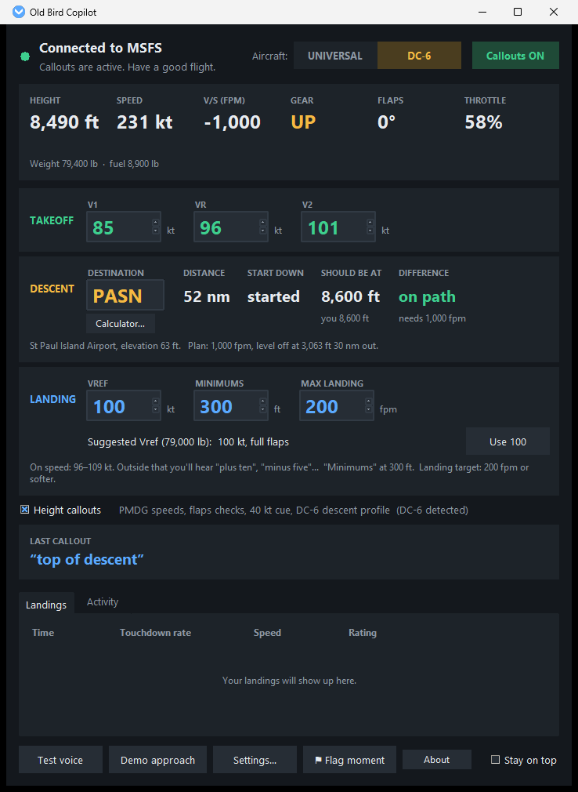

# Old Bird Copilot

**A spoken copilot for classic airliners in Microsoft Flight Simulator 2024.**

Old Bird Copilot is a free Windows app that sits next to the sim and talks to you like a first officer: take-off calls, descent planning, speed and height callouts on approach, a landing check, and a grade for your touchdown. It was made for the **PMDG DC-6**, and it works in any aircraft.

> **Freeware, for Microsoft Flight Simulator 2024 only, and for entertainment only.** Not intended for real-world aviation, navigation, training or any safety-critical use. Old Bird Copilot is an independent third-party project, not affiliated with, endorsed by, sponsored by or supported by Microsoft, Asobo Studio or PMDG. Their product names are used only to describe compatibility.

## Why I made it

I fly NeoFly freight missions in the PMDG DC-6 around Alaska: short runways, low circuits, and the kind of weather that rolls in off the Bering Sea. On those approaches there's no time to stare at the airspeed tape. Hearing "plus ten", "five hundred, stable", "minimums" and "flaps full, three green" in my ear helps immensely. I use it on every flight, and I hope it helps you too.

## The rest of your crew

The PMDG DC-6 comes with an **Artificial Flight Engineer (AFE)** that runs the engines, flaps, gear and checklists. Old Bird Copilot was built to fly **alongside the AFE**, as the first officer in the right seat: calling speeds, heights and warnings, planning the descent, checking you're configured and stable, and telling you how the landing went. It works just as well **without the AFE**, and in other aircraft.

## What it does

**Take-off**
- "Vee one", "rotate", "positive rate" from the V-speeds you enter.
- In the DC-6 it suggests V1, VR and V2 from your live weight (PMDG's tables, wet or dry), and says "check flaps" if you start the roll without take-off flaps.

**Descent**
- Type your destination's airport code (about 44,000 airports, seaplane bases included). The **Descent** panel shows the distance, when to start down, where you should be right now, and how far off the path you are.
- Michael says "request descent" 2 minutes before the top of descent (time to ask ATC), then "top of descent", and "high on profile" if you're well above the path.
- In the DC-6 it flies the classic profile: 1,000 fpm at cruise power down to a level-off 3,000 ft above the field about 30 nm out, with "five hundred to level off".
- A **descent calculator** answers "I'm at 15,000 ft, when do I start down?", with a slider for your descent rate.

**Approach and landing**
- Height callouts (Boeing or Airbus style), "approaching minimums" and "minimums".
- A wind check at 1,000 ft ("wind two seven zero at fifteen, crosswind ten from the left"), with a crew remark when the crosswind is strong ("these are some crosswinds!").
- Speed calls against your Vref: "plus ten", "minus five", then "ref" when you're back on speed. In the DC-6 it suggests the Vref from your live weight.
- "Five hundred, stable", or "unstable, speed" and what's off.
- A DC-6 landing check at 300 ft: "flaps full, three green", or "check flaps".
- Warnings: "sink rate", "too low, gear", "flap speed", "gear speed".
- After touchdown: your landing rate, e.g. "one three two, within target" for a soft-landing mission. The Landings list keeps a log of every touchdown. In the DC-6, "forty knots" reminds you to come out of reverse.

**And**
- **Michael**, a natural-sounding voice built in (Kokoro's am_michael). It works offline, and the Windows voices are there if you prefer them.
- Reads the sim only. It never changes your aircraft, needs no internet, and sends nothing anywhere.
- Records each flight so a problem can be traced afterwards. Press **Flag moment** when something sounds wrong.

## Download and install

1. Download **`OldBirdCopilot-Setup-<version>.exe`** from the [Releases](../../releases) page.
2. Run it. It installs for your Windows user only, so it doesn't ask for administrator rights.
3. Windows may say **"Windows protected your PC"**. The app is free and isn't signed with a paid certificate. If you downloaded it from this page, click **More info**, then **Run anyway**.
4. Start **Old Bird Copilot** from the Start menu. It connects to MSFS 2024 by itself, whether the sim is already running or started later.

**Requirements:** Windows 11 and Microsoft Flight Simulator 2024. Nothing else: no Python, SPAD.next, FSUIPC, Axis and Ohs or MobiFlight, and nothing goes into the Community folder.

Prefer no installer? A **portable zip** is on the Releases page too. Extract it anywhere (e.g. Documents) and run `OldBirdCopilot.exe`.

**Updating:** run the new setup. Your settings and flight recordings are kept.
**Uninstalling:** Windows Settings > Apps > Old Bird Copilot > Uninstall. It asks whether to remove your settings and recordings too, and keeps them unless you say yes.

## Using it

1. Start the app whenever you like, before or after the sim.
2. Fill in the panels; all are optional:
   - **Takeoff:** V1, VR, V2. In the DC-6, click **Use** on the suggestion.
   - **Descent:** your destination's airport code.
   - **Landing:** Vref, minimums (feet above the runway), and a max landing rate if your mission has one.
3. Fly. **Callouts ON/OFF** mutes Michael, **Settings…** changes the voice, which heights are called, warnings and more, and **About** shows where your settings and logs are kept.

The **Aircraft** switch at the top picks **DC-6** by itself when the PMDG DC-6 is loaded, and **Universal** for anything else. Flying something that calls out heights by itself (most modern airliners)? Untick **Height callouts**.

The full user guide is [docs/Read Me First.txt](docs/Read%20Me%20First.txt).

## Help

- **Stuck on "Waiting for MSFS"**: load into a flight. The sim has to be past its main loading screen.
- **No sound**: click **Test voice** and check your Windows sound output.
- **A robotic voice instead of Michael**: the Activity tab says why. Running setup again usually fixes it.
- **Something sounded wrong in flight**: press **Flag moment**, and include the flight recording from your settings folder (About > Open that folder) when you report it on the [Issues](../../issues) page.

## Tested with

- **Windows 11 Home** with **Microsoft Flight Simulator 2024** (Microsoft Store version). The Steam version uses the same connection but hasn't been tried yet.
- **Mostly the PMDG DC-6A**, on NeoFly freight runs in Alaska. That's where nearly all the testing happened.
- **Universal mode** (the **UNIVERSAL** side of the Aircraft switch, for every other aircraft) uses the same callouts without the DC-6 extras. It has only had a little testing so far, so reports from other aircraft are very welcome.
- **MSFS 2020 hasn't been tried.** The app is made for MSFS 2024, but it talks to the sim the same way 2020 does, so it might just work. If you try it, or fork it to make it work, let me know.

See [docs/RELEASE_CHECKLIST.md](docs/RELEASE_CHECKLIST.md) for exactly what was tested.

## Credits

- Voice "Michael": the [Kokoro-82M](https://huggingface.co/hexgrad/Kokoro-82M) am_michael voice (Apache-2.0), run with [kokoro-onnx](https://github.com/thewh1teagle/kokoro-onnx), [ONNX Runtime](https://onnxruntime.ai/), [phonemizer](https://github.com/bootphon/phonemizer) and [eSpeak NG](https://github.com/espeak-ng/espeak-ng). The full notices are in `voice/THIRD-PARTY-NOTICES.txt`.
- Airport data from [OurAirports](https://ourairports.com/data/) (public domain).
- DC-6 speeds from PMDG's DC-6 operating manual tables.

## For developers

How to run from source, build the installer and make a release is in [docs/DEVELOPING.md](docs/DEVELOPING.md).

## Freeware: fork it, change it, share it

Old Bird Copilot is **freeware**. It's free to download and use, and you're welcome to **fork and modify it**: add your own aircraft, callouts or voice, and share what you make.

It's licensed under the **GNU Affero General Public License v3.0** ([LICENSE](LICENSE)). In short: you may use, study, change and share it, and if you share a modified version, you share its source code under the same licence, so every fork stays free too.

Copyright © 2026 Old Bird Copilot.
